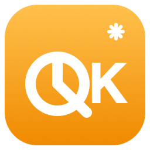

<div align="center">
  
  <h1>quota-keeper</h1>
  <p><b>Keep your Codex 5-hour rate-limit window anchored — automatically.</b></p>
  <p><a href="README.md">English</a> · <a href="README.zh-CN.md">简体中文</a></p>
  <p>
    <a href="LICENSE"></a>
    
    <a href="../../actions/workflows/release.yml"></a>
  </p>
</div>

quota-keeper is a tiny Go CLI + tray app that **automatically detects and re-anchors the 5-hour usage window** of ChatGPT/Codex subscriptions. Single binary, daemon core with zero third-party dependencies.

## Why

The 5-hour window of a Codex subscription resets at a time decided **server-side** — you only learn it from response headers when making a request. Guessing the reset with a fixed cron wastes the beginning of every window. quota-keeper reads the authoritative `x-codex-primary-*` (5h) and `x-codex-secondary-*` (weekly) rate-limit headers, then fires a minimal request right after each reset, so every window starts at a moment you control.

- **Auto-detect** — parses 5h / weekly usage percent and reset time from every response (server-side authoritative values, not estimates)
- **Auto re-anchor** — triggers right after each window reset; optional daily anchors as a fallback
- **Zero-config credentials** — reuses the local [Codex CLI](https://github.com/openai/codex) login (`~/.codex/auth.json`); expired access tokens are refreshed automatically with the refresh token
- **Multi-model** — track any number of models independently
- **Cross-platform tray console** — macOS menu bar / Windows tray / Linux AppIndicator: live status, trigger-now, pause/resume, log viewer
- **Privacy** — credentials never leave your machine; nothing is uploaded or committed

> ⚠️ **Disclaimer**: quota-keeper talks to a non-public ChatGPT backend endpoint. The interface may change with future Codex releases. Use at your own risk and follow OpenAI's terms of service.

## Install

```bash
go install github.com/TNT-Likely/quota-keeper@latest
```

or grab a binary from [Releases](../../releases) (daemon + tray for macOS / Windows / Linux), or build from source:

```bash
go build -o quota-keeper .            # daemon / CLI (stdlib only)
go build -o quota-keeper-tray ./tray  # tray console (uses fyne.io/systray)
```

Prerequisite: log in with the Codex CLI at least once (`~/.codex/auth.json` exists).

## Quick start

```bash
mkdir -p ~/.config/quota-keeper
cp config.example.json ~/.config/quota-keeper/config.json
$EDITOR ~/.config/quota-keeper/config.json   # set models and anchors
quota-keeper once     # run one detection cycle
quota-keeper status   # inspect window state and next action
```

## Commands

| Command | Description |
| --- | --- |
| `run` | Resident daemon: triggers at anchors / window resets (pair with launchd/systemd) |
| `once` | Run one detection cycle and exit |
| `trigger [model]` | Trigger once, right now (defaults to the first configured model) |
| `status` | Show window state, countdowns and the next action per model |
| `refresh-token` | Force-refresh the credentials and write auth.json back |
| `pause` / `resume` | Pause/resume auto-triggering (paused marker file) |

## Scheduling

For each tracked model the daemon fires at the **earlier** of:

1. **Window reset + buffer** (default 60s): from the server's `x-codex-primary-reset-at` header. If the previous window was exhausted (429), the fresh window is anchored immediately after the reset; if not, one minimal request keeps the chain going.
2. **Daily anchors** (optional): fixed `HH:MM` moments as a fallback, so the account is never left unanchored for long.

A 401 automatically refreshes the credentials and retries once; network errors back off for `error_retry_seconds`; a pid file prevents duplicate daemons.

> Server semantics: the reset time is fixed by the **first request** of a window — extra requests inside the window do not extend it. The chain therefore re-anchors shortly after every reset, and the anchor config is only a fallback.

## Tray console (optional)

`quota-keeper-tray` is a cross-platform tray app in the same repository (macOS menu bar / Windows tray / Linux AppIndicator):

- Always-visible status: ✓/⏳ + 5h usage + reset countdown + **next trigger time** (refreshed every 30s)
- Trigger now / Pause daemon / Resume daemon / Open log (trigger history) / Quit

Icons are embedded as generated source (`tray/icon_data.go`); after replacing `tray/*.png`, regenerate with:

```bash
go run ./tools/gen_icon_data
```

> macOS tip: building the tray needs cgo. If your CommandLineTools and SDK are mismatched (`tapi error: unknown architecture`), point the build at a full Xcode: `DEVELOPER_DIR=/Applications/Xcode.app/Contents/Developer go build ./tray`.

## Autostart (macOS launchd)

`~/Library/LaunchAgents/dev.tnt.quota-keeper.plist`:

```xml
<?xml version="1.0" encoding="UTF-8"?>
<!DOCTYPE plist PUBLIC "-//Apple//DTD PLIST 1.0//EN" "http://www.apple.com/DTDs/PropertyList-1.0.dtd">
<plist version="1.0">
<dict>
  <key>Label</key>
  <string>dev.tnt.quota-keeper</string>
  <key>ProgramArguments</key>
  <array>
    <string>/bin/bash</string>
    <string>-c</string>
    <string>exec $HOME/.local/bin/quota-keeper run</string>
  </array>
  <key>RunAtLoad</key>
  <true/>
  <key>KeepAlive</key>
  <true/>
  <key>StandardOutPath</key>
  <string>/dev/null</string>
  <key>StandardErrorPath</key>
  <string>/dev/null</string>
</dict>
</plist>
```

```bash
launchctl bootstrap gui/$(id -u) ~/Library/LaunchAgents/dev.tnt.quota-keeper.plist
```

(The tray can be started the same way with `RunAtLoad` and `KeepAlive` set to `false`.)

## Configuration

| Field | Default | Description |
| --- | --- | --- |
| `models` | `["gpt-5.6-luna"]` | Models to track / trigger |
| `anchors` | empty | Daily anchors `["HH:MM", ...]`; delete if you don't need them |
| `auth_path` | `~/.codex/auth.json` | Codex CLI credentials path |
| `state_path` | `~/.local/state/quota-keeper/state.json` | State file (includes `next_event`) |
| `log_path` | `~/.local/state/quota-keeper/quota-keeper.log` | Log file |
| `endpoint` | ChatGPT Codex backend | Request endpoint |
| `window_minutes` | `300` | Fallback window length when the server doesn't send one |
| `refresh_buffer_seconds` | `60` | Delay after the reset point before triggering |
| `error_retry_seconds` | `300` | Retry interval after errors |
| `tick_seconds` | `20` | Daemon loop interval |

## Privacy & security

Credentials are read and written locally only (`auth.json` and `config.json` should stay `0600`). `config.json`, state, logs and generated binaries are git-ignored and never leave your machine.

## Roadmap

- [x] Cross-platform tray console
- [ ] Claude provider (Keychain credentials, Anthropic OAuth)
- [ ] CLIProxyAPI transport (for credentials that live behind a proxy)
- [ ] Autostart helpers for Windows / Linux

## License

[MIT](LICENSE)
